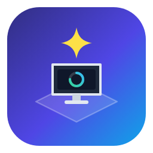
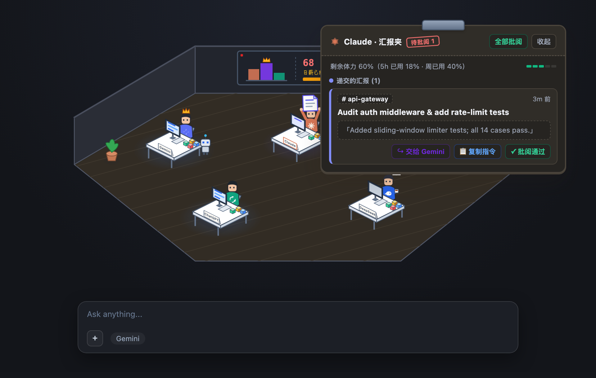

<div align="center">



# agy-lite-hud

**Lightweight, zero-dependency CDP HUD & 2.5D Pixel Agent Office for Google Antigravity (macOS).**

[](https://github.com/rockcli/agy-lite-hud)
[](https://nodejs.org)
[](LICENSE)

English | [简体中文](README.zh-CN.md)

<br />



</div>

## Features

- 🏢 **2.5D Pixel Agent Office** — Turns the Antigravity New Conversation page into an interactive isometric studio with 4 agent workstations (**Gemini**, **Claude**, **ChatGPT**, **DeepSeek**), a corner server rack for background tasks, and a live wall leaderboard.
- 📬 **Briefing Dossier & One-Click Handoff** — Click any workstation to inspect active/unread tasks, copy resume commands (`claude --resume` / `codex resume`), mark items as reviewed, or hand off context directly into the Antigravity composer.
- 🟢 **Context Remaining Ring** — Injects a clean, non-intrusive context-remaining ring right beside the composer `+` (*Add context*) button.
- 🌿 **Compact Sidebar Branch Icon** — Collapses the second-line git branch/worktree label in sidebar conversation rows into a crisp `13x13` branch icon.
- ⚡ **Local Speed Sample Export** — Writes completed generation samples (`id`, `model`, `outputTokens`, `ttft`, `stream`, `completedAt`) locally to `~/.config/howmanyusage/agy-speed.json`.

## Optional Local Integrations

`agy-lite-hud` works standalone out of the box and gracefully skips any missing local source:

| Integration | Local Source | What It Enables |
|---|---|---|
| **Claude Code** | `~/.claude/projects` | Live & recent Claude sessions on the Claude desk |
| **Codex CLI** | `~/.codex/sessions` | Live & recent Codex threads on the ChatGPT desk |
| **DSH** | `~/.agents/skills/dsh-session-bridge` | DSH sessions on the DeepSeek desk |
| **[HowManyUsage](https://github.com/rockcli/howmanyusage)** | `~/.config/howmanyusage/{usage-history.json,state.json}` | Desk stamina blocks, strike alerts, Colab CU on the server rack, and wall leaderboard |

## Quick Start

Requires **macOS**, **Node.js 22+** (built-in `WebSocket` & `fetch`), and **Google Antigravity** running with CDP enabled (reads `~/Library/Application Support/Antigravity/DevToolsActivePort`, or override via `AG_CDP_PORT`).

```bash
git clone https://github.com/rockcli/agy-lite-hud.git
cd agy-lite-hud
./install.sh
```

`./install.sh` registers and starts a `LaunchAgent` (`com.local.agy-lite-hud`) that watches local files and auto-reloads changes into Antigravity.

**Manual / one-shot usage:**

```bash
node watcher.mjs --once     # inject once and exit
node watcher.mjs --remove   # remove injected DOM and styles
```

**Uninstall:**

```bash
./uninstall.sh
```

## Disclaimer

This project injects local CSS/JS into your running Antigravity desktop client via Chrome DevTools Protocol (`127.0.0.1`) and reads only local session/state files on your Mac. Zero telemetry, zero external network requests. Internal DOM selectors and store shapes may change with Antigravity updates.

## License

[MIT](LICENSE) © [rockcli](https://github.com/rockcli)
