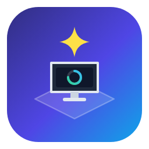
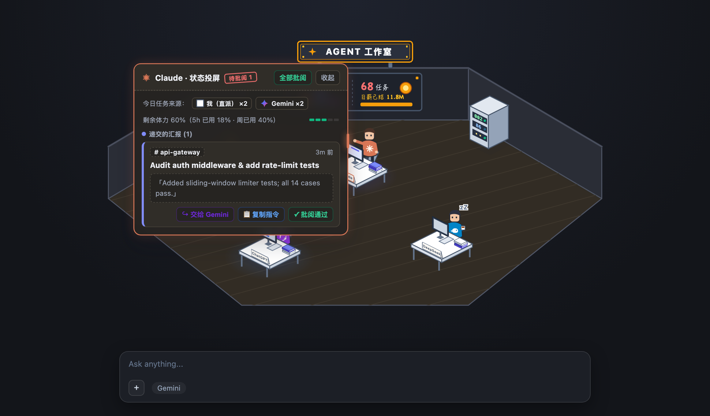

<div align="center">



# agy-lite-hud

**轻量、零依赖的 Google Antigravity (macOS) CDP 增强面板与 2.5D 像素工位看板。**

[](https://github.com/rockcli/agy-lite-hud)
[](https://nodejs.org)
[](LICENSE)

[English](README.md) | 简体中文

<br />



</div>

## 核心特性

- 🏢 **2.5D 像素 Agent 办公室** — 挂载新对话首页时自动隐藏原生大 Logo 与招呼语，呈现等距 **AGENT 工作室** 像素办公室：固定 3 个主流工位（**Gemini**、**Claude**、**ChatGPT**）+ 1 个**开放工位**（4 号位：自动承接 **OpenCode** 或 **DSH**，并预留可扩展骨架）、子代理小助手、3 格机房服务器（`00N` 后台任务、Colab CU 读数、眨眼小像素眼）及墙面销冠榜。未安装的外部 Agent 会优雅降级为**空工位待入驻**（无打盹假人、敲锣不唤醒、榜单不刷 0），点击即可查看接入指引。
- 🖥️ **全息状态投屏与一键交接** — 点击忙碌或待批阅小人时，小人会起身指向身侧悬浮的「状态投屏」：可查看任务明细、一键复制续写命令（`claude --resume` / `codex resume`）、标记已批阅，或把上下文直接填入 Antigravity 输入框继续处理（点击窗外任意位置或按 `Esc` 收起；跨 Agent 派发的子任务仅在忙碌时展示工作动画，不污染待批阅列表）。
- 📚 **每日派单任务书摞** — 桌面以不同配色的等距书本堆叠展示今日任务来源（本人直派与各 Agent 跨路派单，每日 `00:00` 自动清零）。
- 🟢 **无闪烁上下文余量指示环** — 在输入框 `+`（Add context）按钮旁注入极简上下文余量圆环，支持输入草稿时的实时 Token 估算及同帧无闪烁更新。
- 🌿 **侧边栏分支精简图标** — 收起侧边栏对话行第二行的分支/worktree 文字，仅保留紧凑的 `13x13` 分支图标。
- ⚡ **本地测速采样导出** — 纯本地记录每次生成的测速样本（`id`、`model`、`outputTokens`、`ttft`、`stream`、`completedAt`）至 `~/.config/howmanyusage/agy-speed.json`。

## 可选本地联动

`agy-lite-hud` 可独立开箱即用：未安装的外部 Agent 会显示为干净的空工位与接入引导，未检测到 `howmanyusage` 时墙面默认展示像素柱状图与折线图示意：

| 联动工具 | 读取的本地路径 | 增强效果 |
|---|---|---|
| **Claude Code** | `~/.claude/projects` | 在 2 号工位展示 Claude 近期/运行中会话 |
| **Codex CLI** | `~/.codex/sessions` | 在 3 号工位展示 Codex 近期/运行中线程 |
| **OpenCode** | `~/.local/share/opencode/opencode.db`（兼容旧版 `storage/session`） | 在 4 号开放工位展示 OpenCode 会话 |
| **DSH** | `~/.dsh` 与 `dsh-session-bridge` | 在 4 号开放工位展示 DSH 会话；同时安装多个 4 号位 Agent 时按最近活跃自动切换，也可在投屏内手动切换或用 `AG_SLOT4_AGENT=opencode\|dsh` 固定 |
| **[HowManyUsage](https://github.com/rockcli/howmanyusage)** | `~/.config/howmanyusage/{usage-history.json,state.json}` | 投屏内体力条、额度耗尽罢工提醒、机房 Colab CU 与墙面实时销冠榜 |

## 快速开始

环境要求：**macOS**、**Node.js 22+**（内置 `WebSocket` 与 `fetch`），以及已开启 CDP 调试端口的 **Google Antigravity**（自动读取 `~/Library/Application Support/Antigravity/DevToolsActivePort`，也可通过环境变量 `AG_CDP_PORT` 指定）。

```bash
git clone https://github.com/rockcli/agy-lite-hud.git
cd agy-lite-hud
./install.sh
```

`./install.sh` 会注册并启动 `LaunchAgent`（`com.local.agy-lite-hud`），监听本地文件改动并自动热更新注入到 Antigravity。

**手动 / 单次命令：**

```bash
node watcher.mjs --once     # 单次注入后退出
node watcher.mjs --remove   # 卸载已注入的 DOM 与样式
```

**卸载：**

```bash
./uninstall.sh
```

## 免责声明

本工具仅通过本机 Chrome DevTools Protocol（`127.0.0.1`）向运行中的 Antigravity 桌面端注入本地样式与脚本，读取本机已有会话与状态文件，并在本地记录测速样本（`~/.config/howmanyusage/agy-speed.json`）与 `watcher.log`；无遥测、无外部网络请求。内部 DOM 选择器与前端 Store 结构可能随 Antigravity 版本更新而变化。

## 许可证

[MIT](LICENSE) © [rockcli](https://github.com/rockcli)
